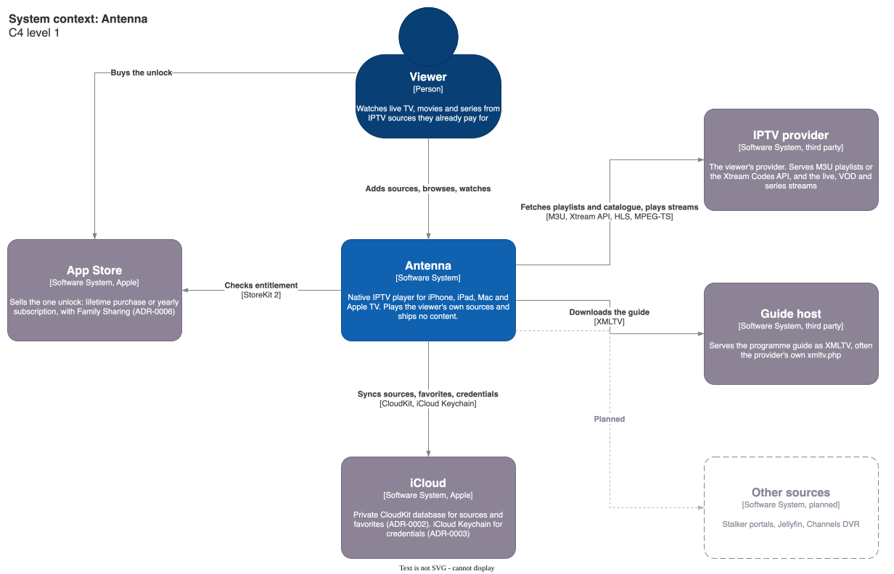
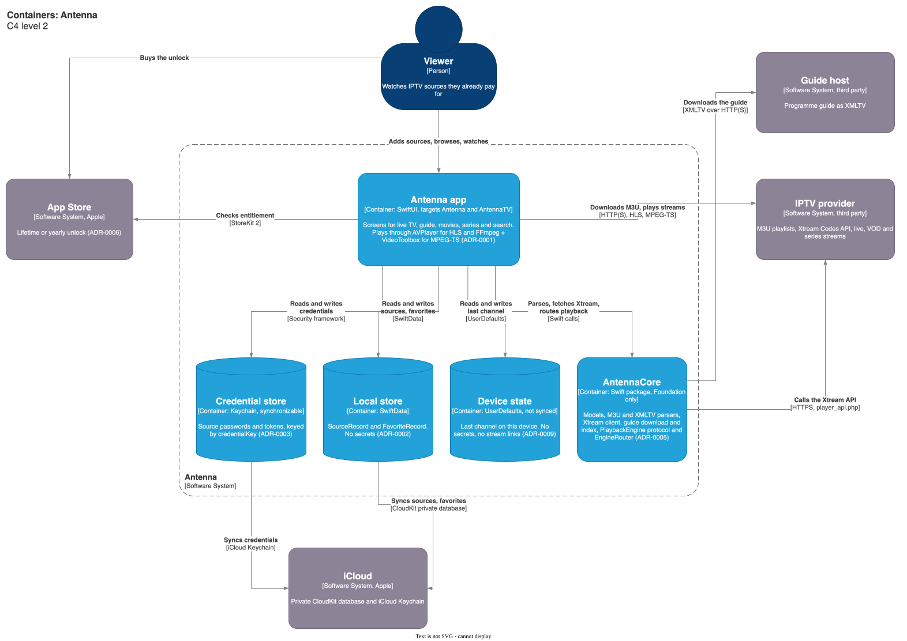

# Architecture

C4 diagrams of Antenna as it is on main. The hard constraints in
[openspec/config.yaml](../../openspec/config.yaml) say why it looks this way.

## System context



## Containers



## Editing

Each `.drawio.svg` embeds its draw.io source. Open it in draw.io (desktop,
app.diagrams.net, or the VS Code Draw.io Integration extension), edit, and
save in place. There is no separate `.drawio` file. If you work from an
exported `.drawio` copy, export back with `-e` so the SVG keeps its source:

```sh
drawio -x -f svg -e -b 10 -o c4-container.drawio.svg c4-container.drawio
```

A change that touches project.yml, a Package.swift, entitlements,
persistence or playback, or adds a URLSession call, updates these diagrams in
the same PR and records the decision in its `design.md`.
